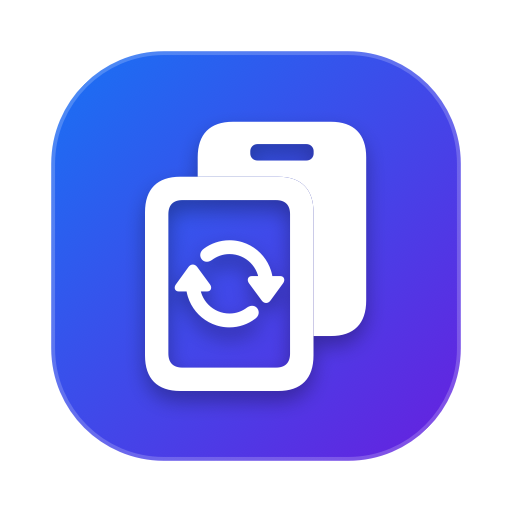
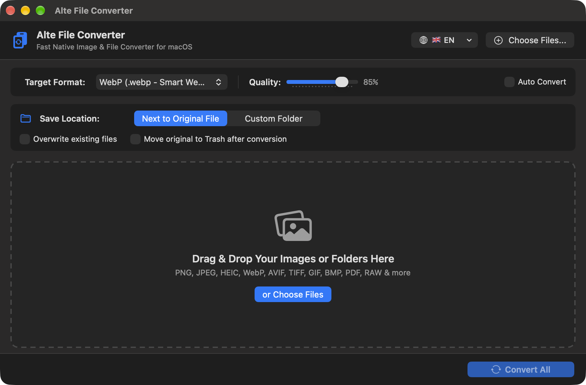
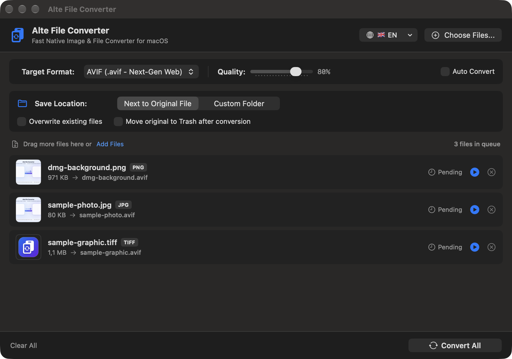
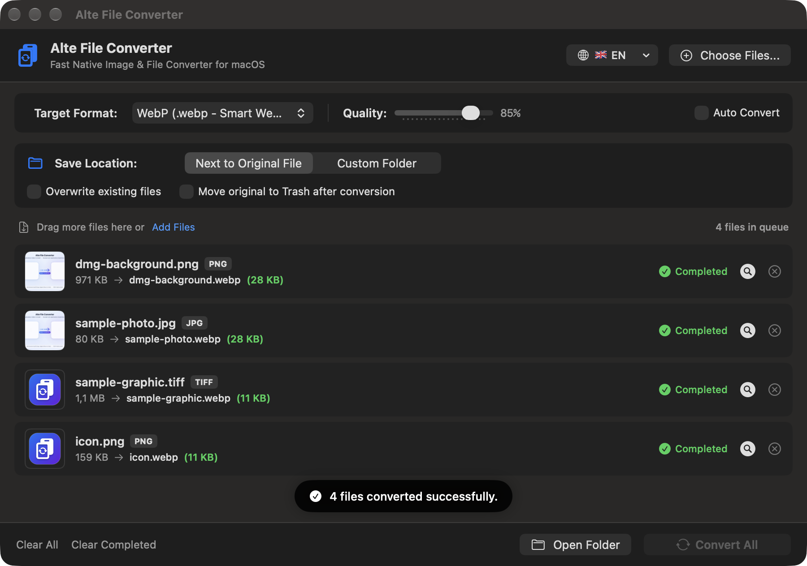

<h1 align="center">📁 Alte File Converter (macOS)</h1>

<p align="center">
  
</p>

<p align="center">
  <b>100% Offline, Native macOS Image & Document Converter built with Swift & SwiftUI.</b><br>
  <i>Hardware-accelerated batch conversion for WebP, JPEG, PNG, HEIC, AVIF, PDF, and Camera RAW formats with zero cloud uploads.</i>
</p>

<p align="center">
  <a href="https://github.com/alte-dev/macos-file-converter/releases/latest"></a>
  
  
  
  
  
  
</p>

<p align="center">
  
</p>

---

## 📥 Download & Installation (macOS)

Download the prebuilt Universal Binary (`arm64` Apple Silicon + `x86_64` Intel) directly from GitHub Releases:

| Package Type | Architecture | Direct Download Link |
| :--- | :--- | :--- |
| 💿 **DMG Installer** *(Recommended)* | Universal (Apple Silicon M1/M2/M3/M4 & Intel) | [**⬇️ Download Alte-File-Converter-macOS.dmg**](https://github.com/alte-dev/macos-file-converter/releases/latest/download/Alte-File-Converter-macOS.dmg) |
| 📦 **ZIP Archive** *(Portable `.app`)* | Universal (Apple Silicon M1/M2/M3/M4 & Intel) | [**⬇️ Download Alte-File-Converter-macOS.zip**](https://github.com/alte-dev/macos-file-converter/releases/latest/download/Alte-File-Converter-macOS.zip) |
| 🏷️ **All Releases** | macOS 12.0 Monterey or later | [**🔗 View GitHub Releases**](https://github.com/alte-dev/macos-file-converter/releases) |

### Installation Steps
1. Download **`Alte-File-Converter-macOS.dmg`** or **`Alte-File-Converter-macOS.zip`** from the links above.
2. **If using DMG:** Double-click the `.dmg` file and drag **`Alte File Converter.app`** into the **`Applications`** folder.
3. **If using ZIP:** Extract the archive and move **`Alte File Converter.app`** to `Applications` (or run it from anywhere).

> 💡 **macOS Gatekeeper Note (First Launch):**
> Because this open-source app is signed with an ad-hoc local signature rather than a paid Apple Developer ID certificate, macOS may show an *"unverified developer"* prompt on first launch:
> * **Right-click (or Control-click)** on `Alte File Converter.app` and select **Open**, **OR**
> * Run the following command once in Terminal:
>   ```bash
>   xattr -cr "/Applications/Alte File Converter.app"
>   ```

## 📸 Screenshots & Interface Tour

### 1. Clean & Modern Drag & Drop Interface
Drop any image, document, or entire directory directly into the window. Configure output formats (`WebP`, `JPEG`, `AVIF`, `PNG`, `PDF`, etc.), set lossy compression quality, toggle auto-conversion, or switch between 8 supported UI languages directly from the header bar.

<p align="center">
  
</p>

### 2. Multi-File Batch Queue & Format Configuration
Easily manage queues with format badges (`PNG`, `JPG`, `TIFF`, etc.), individual file sizes, and status tracking. Convert files individually or process the entire batch at once.

<p align="center">
  
</p>

### 3. High-Efficiency Conversion with Dramatic File Size Savings
Experience 100% local, hardware-accelerated conversion. Real-time file size comparison highlights huge savings (e.g., **971 KB PNG → 28 KB WebP**, representing a **~97% size reduction**) with zero cloud uploads and instant Finder reveal shortcuts.

<p align="center">
  
</p>

---

## ✨ Key Features

* ⚡ **100% Native & Hardware Accelerated:** Built with pure Swift and SwiftUI (no Electron, no web wrappers). Uses macOS `ImageIO`, `CoreGraphics`, and `libwebp` for instant batch conversion.
* 🌐 **Smart WebP Optimization for Websites:** Reduces image file sizes by **60%–85%** for faster website loading (Core Web Vitals / PageSpeed) with Sharp YUV color accuracy, multi-pass compression, and full alpha transparency support.
* 🔒 **100% Offline & Private:** Your photos and documents never leave your Mac. Zero cloud uploads, zero tracking.
* 🌍 **Multi-Language UI (English Default):** Switch languages on the fly from the top-right globe menu (`🇬🇧 English`, `🇹🇷 Türkçe`, `🇩🇪 Deutsch`, `🇪🇸 Español`, `🇫🇷 Français`, `🇷🇺 Русский`, `🇯🇵 日本語`, `🇨🇳 简体中文`). Easily extensible with custom languages.
* 📂 **Drag & Drop Files or Entire Folders:** Drop individual images or nested folders anywhere on the window. Recursive directory scanning automatically discovers all supported files.
* 🎚️ **Lossy Compression Quality Slider:** Fine-tune compression quality from **10% to 100%** for `WebP`, `JPEG`, `JPG`, `HEIC`, and `AVIF` formats and compare original vs. converted file sizes side by side.
* 🎨 **Smart Transparency (Alpha) Flattening:** Automatically composites transparent PNG/WebP/PDF images onto a clean solid white (`#FFFFFF`) background when converting to non-transparent formats like `JPEG` or `BMP` (preventing black backgrounds), while preserving full transparency in `WebP`, `PNG`, `HEIC`, `AVIF`, and `TIFF`.
* 📄 **Crisp 2x Retina PDF Rendering:** Converts PDF pages into high-resolution `2x Retina` raster images (`WebP`, `PNG`, `JPEG`, etc.), or converts images into `.pdf` documents.
* 🚀 **Auto-Convert on Drop Mode:** Enable *"Auto Convert"* to immediately convert files the moment you drop them into the window.

---

## 🔄 Supported Formats

### 📥 Input Formats (Read)
* **Standard & Web Images:** `WebP`, `PNG`, `JPG`, `JPEG`, `HEIC`, `HEIF`, `AVIF`, `TIFF`, `TIF`, `BMP`, `GIF`
* **Design & Icons:** `PSD` (Photoshop), `SVG`, `ICO`, `ICNS`, `TGA`
* **Documents:** `PDF`
* **Camera RAW Formats:** `RAW`, `CR2` (Canon), `NEF` (Nikon), `ARW` (Sony), `DNG` (Adobe / Apple ProRAW)

### 📤 Output Formats (Write)
* **WebP (`.webp`)** — High-efficiency web image format with smart compression, alpha transparency, and quality slider
* **JPEG (`.jpeg`)** — Universal compatibility with adjustable quality slider
* **JPG (`.jpg`)** — Standard `.jpg` extension with adjustable quality slider
* **PNG (`.png`)** — Lossless compression with full alpha transparency
* **HEIC (`.heic`)** — Apple High Efficiency Image Format with quality slider
* **AVIF (`.avif`)** — Next-gen ultra-compact web image format with quality slider
* **TIFF (`.tiff`)** — Lossless format for print and archiving
* **BMP (`.bmp`)** — Uncompressed bitmap image
* **GIF (`.gif`)** — Static GIF image conversion
* **PDF (`.pdf`)** — Convert images directly into PDF documents
* **ICNS (`.icns`)** — Native macOS application icon format

---

## 📖 How It Works (User Guide)

1. **Choose Language (Optional):**
   * By default, the app launches in **English (`🇬🇧 EN`)**. Click the globe button in the top-right header bar to switch to **Turkish (`🇹🇷 TR`)** or any other supported language at any time. Your preference is saved automatically.
2. **Select Target Format & Quality:**
   * Choose your desired output format (`WebP`, `JPEG`, `JPG`, `PNG`, `HEIC`, `AVIF`, `TIFF`, `BMP`, `GIF`, `PDF`, `ICNS`) from the **Target Format** dropdown.
   * For lossy formats (`WebP`, `JPEG`, `JPG`, `HEIC`, `AVIF`), adjust the **Quality** slider between `10%` and `100%` (default is `90%`).
3. **Choose Save Location:**
   * **Next to Original File:** Saves the converted file in the exact same folder as the source file.
   * **Custom Folder:** Saves all converted files into a dedicated directory. Use `Choose Folder...` or the quick-select menu (`...`) for *Desktop*, *Downloads*, or *Pictures*.
4. **Configure Workflow Options:**
   * ☑️ **Auto Convert:** Starts converting immediately when files are dropped.
   * ☑️ **Overwrite existing files:** Replaces existing files with the same name. When unchecked, prevents accidental data loss by naming files `image (1).webp`.
   * ☑️ **Move original to Trash after conversion:** Safely moves the original source file to the macOS Trash once conversion succeeds.
5. **Drop & Convert:**
   * Drag & drop files or folders onto the window (or click **Choose Files...**).
   * Click the ▶️ button on an individual row to convert a single file, or click **Convert All** in the bottom toolbar to batch-process the entire queue.
   * Click the 🔍 (**Reveal in Finder**) icon next to any completed item to highlight the converted file in Finder.

---

## 🌍 Multi-Language Support & Adding New Languages

The app ships with **8 built-in languages** (defaulting to **English**):
* 🇬🇧 **English** (`en` — Default)
* 🇹🇷 **Türkçe** (`tr`)
* 🇩🇪 **Deutsch** (`de`)
* 🇪🇸 **Español** (`es`)
* 🇫🇷 **Français** (`fr`)
* 🇷🇺 **Русский** (`ru`)
* 🇯🇵 **日本語** (`ja`)
* 🇨🇳 **简体中文** (`zh`)

### How to Add a New Language
All translations live in a single, strongly-typed file: [`Sources/Localization.swift`](Sources/Localization.swift). Adding a new language takes less than 2 minutes:

1. Add your language code to the `AppLanguage` enum (e.g., `case it = "it"` for Italian) along with its `flag` and `displayName`.
2. Define a `public static let italian = L10nStrings(...)` instance in `L10n` (the Swift compiler will verify every single UI string at compile time).
3. Register it in `L10n.tables[.it] = italian` and run `./build.sh`. It will immediately appear in the in-app language picker!

---

## 🏗️ Technical Architecture

```text
macos-file-converter/
├── Sources/
│   ├── App.swift                    # App entry point (@main) & window configuration
│   ├── Localization.swift           # Multi-language engine (EN default, TR, DE, ES, FR, RU, JA, ZH)
│   ├── Models.swift                 # UTType format definitions, queue item & state models
│   ├── WebPBridge.h                 # Native C-to-Swift WebP encoder bridge
│   ├── ConverterEngine.swift        # CoreGraphics, ImageIO, PDFKit & WebP conversion pipeline
│   ├── FileConverterViewModel.swift # Async batch queue, recursive folder scanner & state
│   └── Views/
│       ├── ContentView.swift        # Main window, language picker, drop overlay & footer bar
│       ├── SettingsView.swift       # Format, quality slider, destination & workflow toggles
│       ├── ItemRowView.swift        # Queue item row, thumbnail & file size comparison
│       └── DropTargetView.swift     # AppKit NSView full-window drag & drop interceptor
├── Vendor/
│   └── libwebp/                     # Precompiled static WebP libraries & headers
├── AppIcon.icns                     # macOS application icon bundle
├── generate_icon.swift              # Procedural icon generator script
├── generate_dmg_background.swift    # Retina DMG drag-to-install background generator
├── create_dmg.sh                    # Automated styled DMG installer builder
├── Package.swift                    # Swift Package Manager manifest
└── build.sh                         # Universal Binary (arm64 + x86_64) build & codesign script
```

---

## 🛠️ Building from Source

Requirements: **macOS 12.0+** and **Xcode Command Line Tools** (`swiftc`). No external dependencies required.

```bash
# 1. Clone the repository
git clone https://github.com/alte-dev/macos-file-converter.git
cd macos-file-converter

# 2. Build the Universal Binary (.app bundle for Apple Silicon + Intel)
chmod +x build.sh
./build.sh

# 3. (Optional) Build the styled DMG installer
chmod +x create_dmg.sh
./create_dmg.sh

# 4. Launch the app
open "Alte File Converter.app"
```

---

<details>
<summary>🇹🇷 <strong>Türkçe Dokümantasyon (Turkish Overview)</strong></summary>

### Alte File Converter Nedir?
**Alte File Converter**, macOS için tamamen yerel (**Swift & SwiftUI**) olarak geliştirilmiş, internet bağlantısı gerektirmeyen, ultra hızlı toplu görsel ve belge dönüştürme uygulamasıdır.

* **Desteklenen Çıktı Formatları:** `WebP`, `JPEG`, `JPG`, `PNG`, `HEIC`, `AVIF`, `TIFF`, `BMP`, `GIF`, `PDF`, `ICNS`
* **Varsayılan Dil:** İngilizce (`🇬🇧 EN`). Sağ üstteki **küre (🌐)** menüsünden tek tıkla **Türkçe (`🇹🇷 TR`)** veya diğer 6 dile geçiş yapabilirsiniz. Seçtiğiniz dil otomatik kaydedilir.
* **İndirme:**
  * 💿 [**Alte-File-Converter-macOS.dmg İndir**](https://github.com/alte-dev/macos-file-converter/releases/latest/download/Alte-File-Converter-macOS.dmg)
  * 📦 [**Alte-File-Converter-macOS.zip İndir**](https://github.com/alte-dev/macos-file-converter/releases/latest/download/Alte-File-Converter-macOS.zip)
* **İlk Açılış (Gatekeeper):** İlk kez açarken uyarı alırsanız uygulamaya **Sağ Tık → Aç** yapabilir veya Terminal'de `xattr -cr "/Applications/Alte File Converter.app"` komutunu çalıştırabilirsiniz.

</details>

---

## 📄 License

Developed by **Umut Demir (Alte)**. Open source and free for macOS users.
